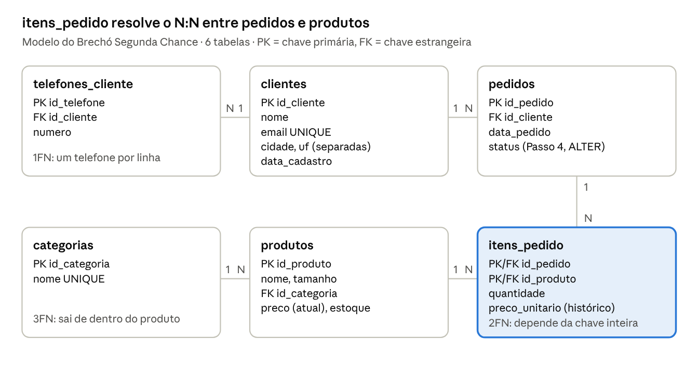

# Guia do aluno — Resolvendo o case Brechó Segunda Chance

11/11/2026 · T&D Growdev

Este guia refaz, passo a passo, o case resolvido pelo mentor na aula ao vivo. Em cada passo você encontra o comando, o que ele faz e, principalmente, **por que** ele é escrito assim. Siga na ordem: cada passo usa o resultado do anterior.

## Antes de começar

**O que você precisa:**

- PostgreSQL e DBeaver instalados e conectados (videoaula *Configurando o Ambiente*).
- Os 3 scripts da aula: `brecho_01_planilha.sql`, `brecho_02_estrutura_e_carga.sql` e `brecho_03_gabarito.sql`. Use-os para conferir, mas tente digitar os comandos você mesmo: é digitando que o SQL fica na memória.

**Como executar SQL no DBeaver:**

- `Ctrl+Enter` executa a instrução onde está o cursor, ou o trecho que você selecionou.
- `Alt+X` executa o arquivo inteiro.
- Cada instrução termina com `;`. Sem ele, o DBeaver pode juntar dois comandos num só.

**A história do case:** o Brechó Segunda Chance vende roupas usadas pela internet e controla todas as vendas numa única planilha. Com só 10 pedidos já apareceram cadastro duplicado, cidade escrita de dois jeitos e telefone misturado na mesma célula. Sua missão, como dev do squad, tem 3 entregas: **modelar** o banco que substitui a planilha, **construí-lo** no PostgreSQL com os dados migrados e **responder** às perguntas do negócio com SQL.

**Se algo der errado no caminho:** rode de novo o script 01 (até a linha 52) e refaça os passos seguintes. Ele começa apagando o schema `brecho` inteiro, então sempre te devolve a um começo limpo.

## Passo 0 · Recriar a planilha no banco

**Objetivo:** ter os dados brutos do brechó dentro do PostgreSQL, exatamente como vieram da planilha, para analisá-los com SQL.

**A planilha original** está no Google Sheets: [Brechó Segunda Chance — Planilha de vendas](https://docs.google.com/spreadsheets/d/1bH1KQhNo8Q9PKOJoOsg9Trnh33vq8Y08cww1GGLewCY/edit), aba `vendas`. Abra e observe as 17 linhas antes de seguir. O script abaixo recria exatamente essa planilha dentro do PostgreSQL, para que você possa analisá-la com SQL.

Rode o `brecho_01_planilha.sql` **até a linha 52**. Os comandos principais:

```sql
DROP SCHEMA IF EXISTS brecho CASCADE;
CREATE SCHEMA brecho;

CREATE TABLE brecho.planilha_vendas (
    pedido            VARCHAR(10),
    data_pedido       VARCHAR(10),
    cliente_nome      VARCHAR(100),
    cliente_email     VARCHAR(100),
    cliente_telefones VARCHAR(100),
    cliente_cidade_uf VARCHAR(100),
    produto           VARCHAR(100),
    categoria         VARCHAR(50),
    tamanho           VARCHAR(5),
    preco             VARCHAR(10),
    quantidade        VARCHAR(5)
);
```

**Por que assim:**

- `CREATE SCHEMA brecho` cria uma "pasta" só para o projeto. Assim nada se mistura com outras tabelas do seu banco, e todo nome passa a ser `brecho.<tabela>`.
- `DROP SCHEMA IF EXISTS ... CASCADE` apaga o schema e tudo dentro dele, se existir. Isso deixa o script **reexecutável**: você pode rodar quantas vezes quiser e sempre recomeça do zero.
- **Tudo como `VARCHAR`:** é assim que dados chegam de uma planilha exportada. Essa tabela de chegada se chama *staging*. A conversão para número e data acontece depois, no Passo 3.

O script segue com 17 `INSERT`s e termina com duas consultas. Confira: **17 linhas e 10 pedidos**.

```sql
SELECT COUNT(*) AS linhas, COUNT(DISTINCT pedido) AS pedidos
FROM brecho.planilha_vendas;
```

`COUNT(DISTINCT pedido)` conta pedidos diferentes. A diferença entre 17 e 10 já é a primeira pista: um pedido com vários produtos ocupa várias linhas.

## Passo 1 · Diagnosticar a planilha

**Objetivo:** encontrar, com SQL, cada problema que a normalização vai resolver. Rode as consultas das linhas 55 a 86 do script 01, **uma por vez**.

| # | Consulta | O que você vê | Nome do problema | Como será resolvido |
| --- | --- | --- | --- | --- |
| 1 | Linhas da Ana | Nome, e-mail e cidade copiados em 3 linhas | Redundância | Tabela `clientes`, um registro por pessoa |
| 2 | Cidades do Bruno | "Canoas/RS" e "canoas/rs" | Anomalia de atualização | Cidade guardada num lugar só |
| 3 | Telefones com `;` | Dois números na mesma célula | Viola a 1FN | Tabela `telefones_cliente`, um número por linha |
| 4 | Preços da camiseta | 29,90 até 02/11, 34,90 depois | Preço muda com o tempo | `preco_unitario` guardado em cada item vendido |
| 5 | Categorias | "Camisetas" repetido em cada produto | Viola a 3FN | Tabela `categorias` |
| 6 | Pedido 1002 | Único registro do tênis | Anomalia de exclusão | Produto existe na própria tabela `produtos` |

Exemplo, a consulta 2:

```sql
SELECT DISTINCT pedido, cliente_cidade_uf
FROM brecho.planilha_vendas
WHERE cliente_email = 'bruno.lima@email.com';
```

**Por que assim:** `WHERE` filtra só as linhas do Bruno; `DISTINCT` remove linhas repetidas para mostrar só as versões diferentes da cidade.

**A regra das 3 formas normais, em uma frase cada:**

- **1FN:** cada célula guarda um único valor. Telefones juntos e "cidade/UF" violam.
- **2FN:** numa tabela com chave composta (pedido + produto), cada coluna depende da chave inteira. O nome do produto depende só do produto, então sai dali.
- **3FN:** nenhuma coluna depende de outra coluna que não é chave. A categoria depende do produto, então ganha tabela própria.

## Passo 2 · Desenhar o modelo

**Objetivo:** decidir quais tabelas existem e como se ligam, antes de escrever qualquer SQL. Mudar o modelo depois que o sistema está no ar custa caro.

**1. Conceitual: o que existe no mundo real do brechó?** Cliente, telefone, pedido, produto e categoria.

**2. Cardinalidade: quantos de um para quantos do outro?**

- Um cliente faz vários pedidos; um pedido é de um só cliente → **1:N**.
- Um cliente tem vários telefones → **1:N**.
- Uma categoria tem vários produtos → **1:N**.
- Um pedido leva vários produtos, e um produto aparece em vários pedidos → **N:N**.

**3. A virada do N:N:** onde guardar que o pedido 1003 levou **2** camisetas? Em `pedidos` não cabe (o pedido tem vários produtos); em `produtos` também não (a camiseta está em vários pedidos). A resposta é uma **tabela associativa**, `itens_pedido`, com uma linha para cada produto de cada pedido.

**4. Lógico: chaves e tipos.** Cada tabela ganha uma PK; cada relação 1:N vira uma FK no lado N. Dinheiro é `NUMERIC(10,2)` (número exato com 2 casas, sem erro de arredondamento) e data é `DATE`, nunca texto.



Cada linha liga a FK de um lado (N) à PK do outro (1). Repare que `itens_pedido` tem duas FKs que, juntas, formam a sua PK.

## Passo 3 · Criar as tabelas e carregar os dados

**Objetivo:** transformar o desenho em tabelas reais (DDL) e migrar os dados da planilha para elas. Script: `brecho_02_estrutura_e_carga.sql`.

**Ordem importa:** crie primeiro as tabelas "pai" (sem FK) e depois as "filhas". Uma FK só pode apontar para uma tabela que já existe.

### 3.1 · Clientes

```sql
CREATE TABLE brecho.clientes (
    id_cliente     SERIAL PRIMARY KEY,
    nome           VARCHAR(100) NOT NULL,
    email          VARCHAR(100) NOT NULL UNIQUE,
    cidade         VARCHAR(60),
    uf             CHAR(2),
    data_cadastro  DATE NOT NULL DEFAULT CURRENT_DATE
);
```

- `SERIAL PRIMARY KEY`: o banco gera o id sozinho (1, 2, 3…) e garante que ele é único e não nulo.
- `NOT NULL`: cliente sem nome ou sem e-mail não entra.
- `UNIQUE` no e-mail: impede o cadastro duplicado que a planilha tinha.
- `cidade` e `uf` separadas: resolve a 1FN. `CHAR(2)` porque UF tem sempre 2 letras.
- `DEFAULT CURRENT_DATE`: se ninguém informar a data de cadastro, o banco usa a de hoje.

### 3.2 · Telefones e categorias

```sql
CREATE TABLE brecho.telefones_cliente (
    id_telefone  SERIAL PRIMARY KEY,
    id_cliente   INT NOT NULL REFERENCES brecho.clientes(id_cliente),
    numero       VARCHAR(20) NOT NULL
);

CREATE TABLE brecho.categorias (
    id_categoria  SERIAL PRIMARY KEY,
    nome          VARCHAR(50) NOT NULL UNIQUE
);
```

- `REFERENCES`: cria a FK. O banco recusa um telefone de cliente que não existe.
- Telefone em tabela própria resolve a 1FN: cada número é uma linha. Telefone é texto porque tem espaço e hífen, e ninguém faz conta com ele.
- Categoria em tabela própria resolve a 3FN. O `UNIQUE` evita "Calçados" duas vezes.

### 3.3 · Produtos e pedidos

```sql
CREATE TABLE brecho.produtos (
    id_produto    SERIAL PRIMARY KEY,
    nome          VARCHAR(100) NOT NULL,
    id_categoria  INT NOT NULL REFERENCES brecho.categorias(id_categoria),
    tamanho       VARCHAR(5),
    preco         NUMERIC(10,2) NOT NULL CHECK (preco > 0),
    estoque       INT NOT NULL DEFAULT 1 CHECK (estoque >= 0)
);

CREATE TABLE brecho.pedidos (
    id_pedido    INT PRIMARY KEY,
    id_cliente   INT NOT NULL REFERENCES brecho.clientes(id_cliente),
    data_pedido  DATE NOT NULL
);
```

- `CHECK`: regra de negócio dentro do banco. Preço zero ou negativo e estoque negativo são recusados, venha o dado de onde vier.
- `DEFAULT 1` no estoque: num brechó, a maioria das peças é única.
- `id_pedido` é `INT` e não `SERIAL`: mantém o número 1001, 1002… que o cliente já conhece.

### 3.4 · Itens do pedido (a tabela associativa)

```sql
CREATE TABLE brecho.itens_pedido (
    id_pedido       INT NOT NULL REFERENCES brecho.pedidos(id_pedido),
    id_produto      INT NOT NULL REFERENCES brecho.produtos(id_produto),
    quantidade      INT NOT NULL CHECK (quantidade > 0),
    preco_unitario  NUMERIC(10,2) NOT NULL,
    PRIMARY KEY (id_pedido, id_produto)
);

CREATE INDEX idx_pedidos_cliente ON brecho.pedidos(id_cliente);
```

- `PRIMARY KEY (id_pedido, id_produto)`: chave composta. O mesmo produto não aparece duas vezes no mesmo pedido; aumenta-se a quantidade.
- `preco_unitario` fica aqui, e não só em `produtos`, porque é o preço **daquela venda**. Se o produto mudar de preço amanhã, o histórico não muda. É o caso da camiseta (29,90 e depois 34,90).
- `CREATE INDEX`: "buscar os pedidos de um cliente" é a consulta mais comum; o índice a deixa rápida, como o índice de um livro.

### 3.5 · Carregar os dados

Agora rode a Parte B do script (linhas 73 a 111). São 6 comandos `INSERT INTO ... SELECT`: em vez de digitar valores, cada um lê a planilha e grava na tabela nova.

| Tabela | O que o comando faz | Por que |
| --- | --- | --- |
| `clientes` | Um registro por e-mail, com a cidade padronizada (`INITCAP`, `UPPER`) | Acaba com a duplicidade e com o "canoas/rs" |
| `telefones_cliente` | Quebra "51 99911-2233; 51 98822-3344" em duas linhas | Aplica a 1FN |
| `categorias` | Pega cada categoria uma vez só (`DISTINCT`) | Aplica a 3FN |
| `produtos` | Um registro por produto, com o preço mais recente | O catálogo mostra o preço atual |
| `pedidos` | Um registro por pedido, convertendo texto em número e data (`CAST`) | Tipos corretos permitem ordenar e somar |
| `itens_pedido` | Uma linha por produto vendido, com o preço daquela venda | Guarda o histórico de preço |

O exemplo mais simples:

```sql
INSERT INTO brecho.categorias (nome)
SELECT DISTINCT categoria FROM brecho.planilha_vendas ORDER BY categoria;
```

Não se preocupe em decorar `SPLIT_PART` ou `REGEXP_SPLIT_TO_TABLE` agora. Importa entender a ideia: os dados saem da staging, são limpos e entram nas tabelas certas.

**Confira:** rode as linhas 113 a 116. As duas colunas devem mostrar **1403.20**. Se forem iguais, nenhum centavo se perdeu na migração.

## Passo 4 · Mudar a estrutura e os dados

**Objetivo:** atender os primeiros pedidos do negócio alterando a tabela (DDL) e os dados (DML), com segurança. Script: `brecho_03_gabarito.sql`, linhas 12 a 48.

### 4.1 · ALTER: a logística quer o status do pedido

```sql
ALTER TABLE brecho.pedidos
  ADD COLUMN status VARCHAR(20) NOT NULL DEFAULT 'pago'
  CHECK (status IN ('pendente','pago','enviado','entregue','cancelado'));
```

**Por que assim:** `ALTER TABLE` muda uma tabela que já tem dados, sem recriá-la. O `DEFAULT 'pago'` preenche os 10 pedidos existentes (senão o `NOT NULL` impediria a coluna). O `CHECK ... IN` aceita só os 5 status válidos: "Enviado" ou "entrege" são recusados.

### 4.2 · INSERT: clientes e peças novas

```sql
INSERT INTO brecho.clientes (nome, email, cidade, uf)
VALUES ('Gabriela Prado', 'gabi.prado@email.com', 'Pelotas', 'RS'),
       ('Helena Duarte',  'helena.d@email.com',   NULL,      NULL);

INSERT INTO brecho.produtos (nome, id_categoria, tamanho, preco, estoque)
VALUES ('Vestido curto de linho',  (SELECT id_categoria FROM brecho.categorias WHERE nome = 'Vestidos'),   'P',  59.90, 1),
       ('Cinto de couro trançado', (SELECT id_categoria FROM brecho.categorias WHERE nome = 'Acessórios'), 'U',  24.90, 2);
```

**Por que assim:**

- Não informamos `id_cliente` nem `data_cadastro`: o `SERIAL` e o `DEFAULT` preenchem sozinhos.
- Helena não informou cidade: `NULL` significa "não sei", diferente de texto vazio.
- Para a categoria, buscamos o id pelo nome com uma subconsulta em vez de decorar que "Vestidos" é o 5. Se o id mudar, o comando continua certo.
- Essas 2 clientes e 2 peças **nunca compraram nem venderam**. Guarde isso: elas são a resposta do Passo 6.

### 4.3 · UPDATE: status e promoção

```sql
UPDATE brecho.pedidos SET status = 'entregue' WHERE data_pedido < '2026-11-01';
UPDATE brecho.pedidos SET status = 'enviado'  WHERE id_pedido IN (1007, 1008, 1009);
UPDATE brecho.pedidos SET status = 'pendente' WHERE id_pedido = 1010;

UPDATE brecho.produtos
SET preco = ROUND(preco * 0.90, 2)
WHERE id_categoria = (SELECT id_categoria FROM brecho.categorias WHERE nome = 'Acessórios');
```

**Por que assim:** o `WHERE` decide **quais** linhas mudam; sem ele, todas mudam. `ROUND(..., 2)` mantém o preço com 2 casas. Afetados: 6, 3 e 1 pedidos; 3 acessórios.

**Pense nisso:** o desconto mudou o preço da Bolsa em `produtos`. O valor do pedido 1003, que comprou a bolsa, mudou? Não: o preço da venda está em `itens_pedido.preco_unitario`. É o histórico funcionando.

### 4.4 · Transação: o erro que todo dev um dia comete

Selecione as 4 linhas abaixo e rode juntas:

```sql
BEGIN;
  DELETE FROM brecho.telefones_cliente;           -- sem WHERE: apaga TUDO
  SELECT COUNT(*) FROM brecho.telefones_cliente;  -- 0
ROLLBACK;
```

Depois rode `SELECT COUNT(*) FROM brecho.telefones_cliente;` de novo: **7 telefones voltaram**.

**Por que assim:** `BEGIN` abre uma transação. Tudo o que acontece dentro dela só vale de verdade no `COMMIT`. O `ROLLBACK` desfaz tudo desde o `BEGIN`. É a **Atomicidade** do ACID: ou tudo, ou nada. Antes de um `UPDATE` ou `DELETE` arriscado em produção, abra uma transação e confira o resultado antes de confirmar.

### 4.5 · DELETE do jeito certo

```sql
DELETE FROM brecho.clientes WHERE email = 'helena.d@email.com';
INSERT INTO brecho.clientes (nome, email) VALUES ('Helena Duarte', 'helena.d@email.com');
```

**Por que assim:** a Helena pediu a exclusão do cadastro (LGPD). O `WHERE` pelo e-mail, que é `UNIQUE`, garante que só ela sai. A reinserção existe só para o exercício: vamos usar a Helena nos Passos 6 e 7. Note que o banco deixou excluir porque ela não tinha pedidos; um cliente com pedidos seria barrado pela FK.

## Passo 5 · Consultar e checar a integridade

**Objetivo:** responder perguntas simples do dia a dia com filtros e ordenação. Script 03, linhas 50 a 70.

### 5.1 · Clientes do RS em ordem alfabética

```sql
SELECT nome, cidade, uf
FROM brecho.clientes
WHERE uf = 'RS'
ORDER BY nome;
```

**Por que assim:** liste só as colunas que a pergunta pede (`SELECT *` traz tudo e pesa mais). `WHERE` filtra as linhas; `ORDER BY` ordena. Resultado: 5 clientes, de Ana Souza a Gabriela Prado.

### 5.2 · Filtros com padrão, nulo e limite

```sql
SELECT nome, preco FROM brecho.produtos
WHERE nome ILIKE '%camiseta%' AND preco < 50
ORDER BY preco;

SELECT nome, email FROM brecho.clientes WHERE cidade IS NULL;

SELECT nome, preco FROM brecho.produtos ORDER BY preco DESC LIMIT 3;
```

**Por que assim:**

- `ILIKE '%camiseta%'`: "contém camiseta", sem diferenciar maiúscula de minúscula (`LIKE` diferencia). O `%` significa "qualquer texto".
- `IS NULL`, e nunca `= NULL`: nulo é "desconhecido", e nada é igual a desconhecido. `= NULL` sempre volta vazio.
- `ORDER BY ... DESC LIMIT 3`: ordena do maior para o menor e pega os 3 primeiros. É o padrão de todo "top N".

### 5.3 · Provando a anomalia com GROUP BY e HAVING

```sql
SELECT cliente_email, COUNT(DISTINCT cliente_cidade_uf) AS versoes_da_cidade
FROM brecho.planilha_vendas
GROUP BY cliente_email
HAVING COUNT(DISTINCT cliente_cidade_uf) > 1;
```

**Por que assim:** `GROUP BY` junta as linhas de cada e-mail num grupo; `COUNT(DISTINCT ...)` conta quantas versões da cidade cada grupo tem; `HAVING` filtra **grupos**, enquanto `WHERE` filtra **linhas**. Resultado: bruno.lima@email.com com 2 versões. A anomalia que você viu no Passo 1 agora está provada com SQL.

## Passo 6 · Cruzar tabelas e resumir

**Objetivo:** depois de normalizar, os dados estão em tabelas separadas. JOIN é como você os junta de volta para responder perguntas. Script 03, linhas 76 a 110.

### 6.1 · INNER JOIN: pedidos com o nome do cliente

```sql
SELECT p.id_pedido, p.data_pedido, c.nome AS cliente, p.status
FROM brecho.pedidos p
INNER JOIN brecho.clientes c ON c.id_cliente = p.id_cliente
ORDER BY p.data_pedido DESC;
```

**Por que assim:** `p` e `c` são apelidos (aliases) que encurtam o código. O `ON` diz qual coluna liga as tabelas: a FK de `pedidos` com a PK de `clientes`. O `INNER` traz só o que tem par dos dois lados: 10 pedidos.

### 6.2 · LEFT JOIN: quem nunca comprou

```sql
SELECT c.nome, c.email
FROM brecho.clientes c
LEFT JOIN brecho.pedidos p ON p.id_cliente = c.id_cliente
WHERE p.id_pedido IS NULL;
```

**Por que assim:** o `LEFT` traz **todos** os clientes, com ou sem pedido. Quem não tem pedido aparece com as colunas de `pedidos` vazias (NULL); o `WHERE ... IS NULL` filtra exatamente esses. Resultado: Gabriela e Helena, cadastradas no Passo 4.

**Teste você:** troque `LEFT` por `INNER` e rode de novo. O resultado fica vazio, porque o INNER descarta justamente quem não tem par. A mesma lógica nas linhas 89 a 92 mostra as peças que nunca venderam: Vestido curto de linho e Cinto.

### 6.3 · Funções agregadas: os números do mês

```sql
SELECT COUNT(DISTINCT id_pedido)        AS pedidos,
       SUM(quantidade * preco_unitario) AS faturamento,
       MIN(preco_unitario)              AS menor_item,
       MAX(preco_unitario)              AS maior_item,
       ROUND(AVG(preco_unitario), 2)    AS preco_medio_item
FROM brecho.itens_pedido;
```

**Por que assim:** sem `GROUP BY`, a agregação resume a tabela inteira numa linha. Faturamento é quantidade × preço de cada item: as 2 camisetas do pedido 1003 contam duas vezes. Resultado: 10 pedidos e 1403.20.

### 6.4 · JOIN de 3 tabelas com GROUP BY: faturamento por categoria

```sql
SELECT cat.nome AS categoria,
       SUM(i.quantidade)                    AS pecas_vendidas,
       SUM(i.quantidade * i.preco_unitario) AS faturamento
FROM brecho.itens_pedido i
JOIN brecho.produtos   pr  ON pr.id_produto    = i.id_produto
JOIN brecho.categorias cat ON cat.id_categoria = pr.id_categoria
GROUP BY cat.nome
ORDER BY faturamento DESC;
```

**Por que assim:** o item sabe o produto, o produto sabe a categoria. Para ir do item à categoria, passamos pelo produto: dois JOINs em sequência. Todo campo do `SELECT` que não está numa função de agregação precisa estar no `GROUP BY`. Resultado: Acessórios lidera com 359.60; Camisetas vende mais peças (7) e fatura menos.

## Passo 7 · Consultas de relatório

**Objetivo:** escrever consultas mais longas que continuam fáceis de ler. Script 03, linhas 112 a 184.

### 7.1 · CASE e COALESCE: programa de fidelidade

```sql
SELECT c.nome || ' (' || COALESCE(c.uf, '--') || ')'     AS cliente,
       COALESCE(c.cidade, 'Não informada')                AS cidade,
       COALESCE(SUM(i.quantidade * i.preco_unitario), 0)  AS total_gasto,
       CASE
         WHEN SUM(i.quantidade * i.preco_unitario) >= 250 THEN 'Ouro'
         WHEN SUM(i.quantidade * i.preco_unitario) >= 100 THEN 'Prata'
         WHEN SUM(i.quantidade * i.preco_unitario) >  0   THEN 'Bronze'
         ELSE 'Sem compras'
       END                                                AS nivel
FROM brecho.clientes c
LEFT JOIN brecho.pedidos      p ON p.id_cliente = c.id_cliente
LEFT JOIN brecho.itens_pedido i ON i.id_pedido  = p.id_pedido
GROUP BY c.id_cliente, c.nome, c.uf, c.cidade
ORDER BY total_gasto DESC;
```

**Por que assim:**

- `||` concatena textos: "Elisa Kato (PR)".
- `COALESCE(valor, substituto)` troca NULL por algo legível. Sem ele, a Helena apareceria sem cidade e com total vazio.
- `CASE` funciona como um "se… senão" e é lido de cima para baixo: o primeiro `WHEN` verdadeiro vence. Por isso a ordem vai do maior limite para o menor.
- `LEFT JOIN` duas vezes, para que clientes sem compra também apareçam (com "Sem compras").

Resultado: Ouro para Elisa (434.60) e Carla (404.50).

### 7.2 · Subquery: peças acima da média

```sql
SELECT nome, preco
FROM brecho.produtos
WHERE preco > (SELECT AVG(preco) FROM brecho.produtos)
ORDER BY preco DESC;
```

**Por que assim:** o banco resolve primeiro a consulta entre parênteses (a média) e usa o número na consulta de fora. Você não precisa saber a média de antemão, e o resultado se atualiza quando o catálogo muda. Resultado: 6 peças.

### 7.3 · CTE com WITH: ticket médio

```sql
WITH total_por_pedido AS (
  SELECT id_pedido, SUM(quantidade * preco_unitario) AS total
  FROM brecho.itens_pedido
  GROUP BY id_pedido
)
SELECT id_pedido, total,
       ROUND((SELECT AVG(total) FROM total_por_pedido), 2) AS ticket_medio
FROM total_por_pedido
WHERE total > (SELECT AVG(total) FROM total_por_pedido)
ORDER BY total DESC;
```

**Por que assim:** ticket médio é a média do valor **por pedido**, não por item. Então primeiro somamos cada pedido (a CTE `total_por_pedido`), e só depois tiramos a média. O `WITH` dá nome a essa etapa e a deixa reutilizável: aqui ela é usada três vezes. Resultado: ticket médio de 140.32 e 4 pedidos acima dele.

### 7.4 · CTE + JOIN + LIMIT: top 3 clientes

As linhas 151 a 161 repetem a ideia: a CTE `gasto` soma o total de cada cliente e a consulta final junta com `clientes` para mostrar o nome. Resultado: Elisa, Carla e Ana.

### 7.5 · VIEW: um relatório pronto

```sql
CREATE OR REPLACE VIEW brecho.vw_vendas_detalhadas AS
SELECT p.id_pedido,
       CAST(p.data_pedido AS VARCHAR(10)) AS data_texto,
       c.nome   AS cliente,
       cat.nome AS categoria,
       pr.nome  AS produto,
       i.quantidade,
       i.preco_unitario,
       i.quantidade * i.preco_unitario AS subtotal,
       p.status
FROM brecho.itens_pedido i
JOIN brecho.pedidos    p   ON p.id_pedido      = i.id_pedido
JOIN brecho.clientes   c   ON c.id_cliente     = p.id_cliente
JOIN brecho.produtos   pr  ON pr.id_produto    = i.id_produto
JOIN brecho.categorias cat ON cat.id_categoria = pr.id_categoria;

SELECT categoria, SUM(subtotal) AS faturamento
FROM brecho.vw_vendas_detalhadas
WHERE status <> 'cancelado'
GROUP BY categoria
ORDER BY faturamento DESC;
```

**Por que assim:** a view salva uma consulta com nome. Quem é da área de dados consulta `vw_vendas_detalhadas` como se fosse uma tabela, sem escrever 4 JOINs. `CAST` converte a data em texto, útil para exportar. Atenção: a view não guarda dados; ela roda a consulta inteira a cada uso. Com milhões de pedidos, isso pesa, e é aí que entram a desnormalização e o OLAP.

## Confira seus resultados

Se seus números baterem com estes, você reproduziu o case inteiro.

| Passo | Consulta | Resultado esperado |
| --- | --- | --- |
| 0 | Linhas e pedidos da planilha | 17 linhas, 10 pedidos |
| 3 | Conferência da carga | 1403.20 nas duas colunas |
| 4 | Telefones depois do ROLLBACK | 7 |
| 5 | Clientes do RS | 5 (Ana, Bruno, Diego, Fábio, Gabriela) |
| 5 | Clientes sem cidade | Helena Duarte |
| 5 | 3 peças mais caras | Bota (159.90), Casaco (129.90), Bolsa (125.91) |
| 5 | E-mail com mais de uma cidade | bruno.lima@email.com, 2 versões |
| 6 | Pedidos com nome do cliente | 10 linhas |
| 6 | Clientes que nunca compraram | Gabriela e Helena |
| 6 | Peças que nunca venderam | Vestido curto de linho e Cinto de couro trançado |
| 6 | Faturamento total | 1403.20 |
| 6 | Categoria que mais fatura | Acessórios, 359.60 |
| 7 | Clientes Ouro | Elisa (434.60) e Carla (404.50) |
| 7 | Peças acima da média | 6 peças |
| 7 | Ticket médio | 140.32, com 4 pedidos acima |
| 7 | Top 3 clientes | Elisa, Carla, Ana |

A Bolsa aparece por 125.91 porque o desconto de 10% do Passo 4 já foi aplicado. Nos pedidos, ela continua valendo 139.90: é o preço histórico.

## Erros comuns e como resolver

| Mensagem ou sintoma | O que aconteceu | Como resolver |
| --- | --- | --- |
| `relation "clientes" already exists` | Você rodou o script 02 duas vezes | Rode o script 01 até a linha 52 e depois o 02 de novo |
| `relation "brecho.clientes" does not exist` | Pulou o Passo 3, ou o schema foi apagado | Rode 01 → 02 |
| `duplicate key value violates unique constraint` | Inseriu o mesmo e-mail ou a mesma chave de novo | Normal se rodou o Passo 4 duas vezes; siga em frente |
| `violates foreign key constraint` | Tentou apagar um registro que outro usa, ou inserir apontando para algo inexistente | É a FK protegendo seus dados; confira o id |
| `violates check constraint` | Valor fora da regra (preço negativo, status inválido) | Corrija o valor: o banco fez o trabalho dele |
| `column "..." must appear in the GROUP BY clause` | Coluna no SELECT que não está agregada nem no GROUP BY | Inclua a coluna no GROUP BY |
| Consulta com `= NULL` volta vazia | NULL não é igual a nada | Use `IS NULL` |
| UPDATE ou DELETE afetou tudo | Faltou o WHERE | Se estava dentro de BEGIN, rode ROLLBACK; senão, refaça 01 → 02 |

## Próximos passos

- [ ] Refaça o case do zero, digitando os comandos sem olhar o gabarito.
- [ ] Crie o repositório `brecho-sql` no GitHub com os 3 scripts e um README contendo o diagrama do modelo e 3 perguntas de negócio que o banco responde.
- [ ] Desafio extra: crie a tabela `avaliacoes` (cliente avalia uma peça que comprou, nota de 1 a 5, com `CHECK`) e descubra qual categoria tem a melhor nota média.
- [ ] Poste o link do repositório no canal da turma para receber code review de um colega.

**Por que publicar:** recrutadores de vagas júnior pedem portfólio. Um repositório com modelo, script e README mostra que você sabe sair de um problema real e chegar a uma entrega, exatamente o que acontece no dia a dia de um squad.
